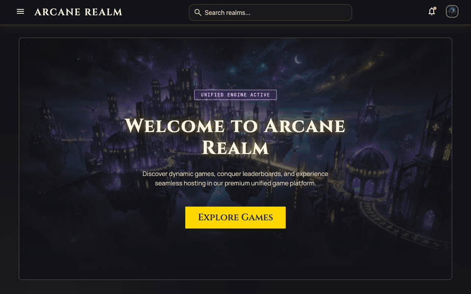
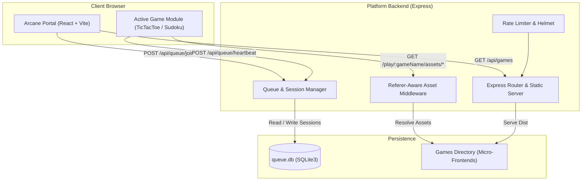

# Arcane Realm — Unified Gaming Platform

[](https://nodejs.org/)
[](https://expressjs.com/)
[](https://react.dev/)
[](https://vitejs.dev/)
[](https://tailwindcss.com/)
[](https://www.sqlite.org/)
[](LICENSE)

An immersive, modular web gaming platform engineered with an **Arcane Cyber-Fantasy** aesthetic. Features dynamic micro-frontend game hosting, concurrent player queue management with SQLite persistence, live platform telemetry, and integrated modular game engines.

---

## 🎬 Sneak Peek



> **Walkthrough highlights:**
> - Responsive glassmorphic landing portal with ambient background orbs and animated live stats.
> - Auto-discovery of installed realms in `Games/` with dynamic launch routes.
> - Interactive gameplay in **Tic Tac Tactics** (with smart Minimax AI and confetti celebrations) and **Sudoku** (with procedural puzzle generation).
> - Fluid transitions between games and the main portal with automatic session heartbeat tracking.
> - Expandable interactive Creator Signature card with 3D spring animations.

---

## ✨ Key Highlights & Features

### 🏰 Arcane Portal Hub
- **Ethereal Aesthetics**: Glassmorphic UI styled with Tailwind CSS, custom fonts, floating animated gradient orbs, and interactive hover cards.
- **Micro-Frontend Architecture**: Dynamic plug-and-play game discovery — any game added to `Games/<GameName>` is automatically indexed and served at `/play/<GameName>`.
- **Referer-Aware Asset Proxying**: Express middleware transparently rewrites and routes absolute asset references (e.g., `/assets/...`) to the respective active game directory, preventing asset collision across different games.

### ⚡ Session & Queue Engine
- **Capacity Limiter**: Restricts active concurrent gameplay slots (configurable, default: 5 players) to ensure server stability.
- **Fair FIFO Queue**: Excess visitors are automatically queued in an SQLite-backed session store with real-time position updates.
- **Heartbeat & Eviction System**: Games ping `/api/queue/heartbeat` every 10 seconds. Inactive or closed sessions are evicted automatically via background cleanup sweeps and `navigator.sendBeacon` unload hooks.
- **Live Platform Telemetry**: Dynamic database-driven counters for active players and total lifetime matches played.

### 🛡️ Production-Grade Security
- **Path Traversal Protection**: Sanitizes game directory paths against directory traversal attacks (`..`, slashes, escapes).
- **Helmet HTTP Hardening**: Injects critical HTTP security headers with tailored CSP configuration for embedded game assets.
- **DDoS & Rate Limiting**: Built-in IP rate limiter (`express-rate-limit`) preventing brute force and denial-of-service abuse.
- **CORS Configurator**: Whitelist-based origin security configurable via environment variables (`ALLOWED_ORIGINS`).

---

## 🎮 Included Realms (Games)

| Realm | Tech Stack | Highlights |
| :--- | :--- | :--- |
| **Tic Tac Tactics** | React 19, TypeScript, Tailwind CSS v4, Motion, Lucide | Smart Minimax AI (multiple difficulty levels), win/draw streak tracking, local state persistence, celebratory confetti animations. |
| **Sudoku** | React 19, Vite, Tailwind CSS, `sudoku-gen` | Procedural board generation, customizable difficulty (Easy to Expert), pencil notes mode, invalid move validation, elapsed timer. |

---

## 🏗️ Architecture Overview



---

## 📁 Repository Structure

```
Unified-Gaming-Platform/
├── package.json               # Root monorepo orchestrator scripts
├── Logo.png                   # Platform brand asset
├── docs/
│   └── sneak-peek.gif         # Animated app demonstration
├── Platform/
│   ├── package.json           # Backend dependencies (Express, SQLite3, Helmet)
│   ├── server.js              # Platform core server & asset proxy
│   ├── queue.js               # Queue controller, heartbeat, and SQLite queries
│   └── portal/                # Frontend Portal SPA
│       ├── package.json       # Portal dependencies (React 19, Framer Motion)
│       ├── vite.config.js     # Vite configuration with API proxies
│       └── src/               # React components, pages, and styling
└── Games/
    ├── TicTacToe/             # Tic Tac Tactics game module
    │   ├── package.json       # Game dependencies & scripts
    │   ├── vite.config.ts     # Vite configuration
    │   └── src/               # Game engine, AI logic, and UI
    └── Sudoku/                # Sudoku game module
        ├── package.json       # Game dependencies & scripts
        ├── vite.config.js     # Vite configuration
        └── src/               # Board generator, controls, and UI
```

---

## 🚀 Getting Started

### Prerequisites
- **Node.js**: v18.0.0 or higher
- **npm**: v9.0.0 or higher

### Installation

1. **Clone the repository:**
   ```bash
   git clone https://github.com/vkn-can-code/Unified-Gaming-Platform.git
   cd Unified-Gaming-Platform
   ```

2. **One-Command Setup:**
   Install dependencies and build all production bundles (`Platform`, `Portal`, and all `Games`):
   ```bash
   npm run setup
   ```

   *(Alternatively, step-by-step)*:
   ```bash
   # 1. Install Platform dependencies
   npm --prefix Platform install

   # 2. Install and build Portal
   npm --prefix Platform/portal install
   npm --prefix Platform/portal run build

   # 3. Install and build Games
   npm --prefix Games/TicTacToe install
   npm --prefix Games/TicTacToe run build

   npm --prefix Games/Sudoku install
   npm --prefix Games/Sudoku run build
   ```

---

## 🕹️ Running the Platform

### Production Mode (Recommended)
Start the unified platform server:
```bash
npm start
```
Open your browser and navigate to:
```
http://localhost:677
```

### Development Mode (Portal Hot-Reload)
For active development on the Portal frontend with Hot Module Replacement (HMR):
```bash
# In terminal 1 (start backend API & games server):
cd Platform
node server.js

# In terminal 2 (start Vite dev server with proxy):
cd Platform/portal
npm run dev
```

---

## ➕ Adding New Games (Plug & Play)

The platform is designed to make adding new games seamless:

1. Create a new folder under `Games/<YourGameName>/`.
2. Initialize your game with any frontend framework (Vite + React, Svelte, Vue, or vanilla HTML5/Canvas).
3. Ensure the build output emits to a `dist/` directory inside your game folder:
   ```bash
   npm run build # outputs Games/<YourGameName>/dist/index.html
   ```
4. Add a "Back to Portal" navigation link in your game UI:
   ```html
   <a href="/">← Back to Portal</a>
   ```
5. Restart or reload the platform — the server automatically indexes the folder, verifies `dist/`, and adds it to the **Trending Realms** showcase!

---

## ⚙️ Configuration & Environment Variables

You can configure platform behavior using environment variables:

| Variable | Description | Default |
| :--- | :--- | :--- |
| `PORT` | HTTP port for the platform server | `677` |
| `ALLOWED_ORIGINS` | Comma-separated list of additional allowed CORS origins | `http://localhost:3000,http://localhost:677` |

Example:
```bash
PORT=8080 ALLOWED_ORIGINS="https://mygameportal.com" npm start
```

---

## 👤 Creator

**Vivek K Nair**
- GitHub: [@vkn-can-code](https://github.com/vkn-can-code)
- LinkedIn: [Vivek K Nair](https://www.linkedin.com/in/vivek-k-nair-38bbb2383/)

---

## 📄 License

This project is licensed under the [MIT License](LICENSE).
